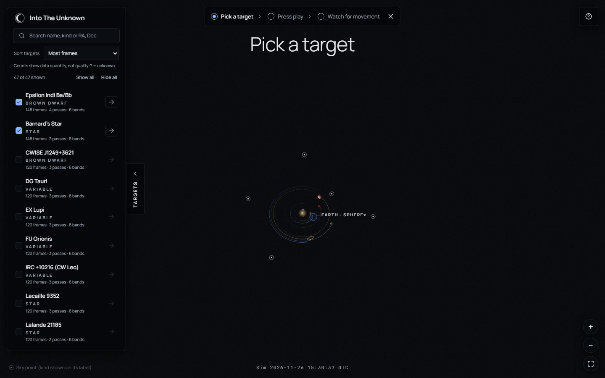
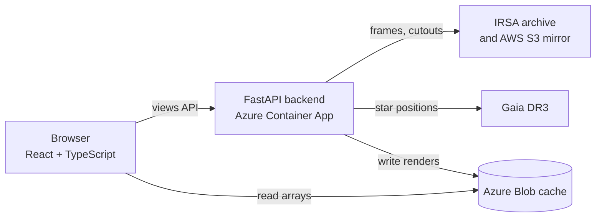

# Into The Unknown

> Team project built for NASA Space Apps 2026 (Planet X and SPHEREx challenge) with team LOGICA: [Om Patel](https://github.com/ompatel181005), [Diego](https://github.com/dflow11), Himanshu, [Ammar](https://github.com/ab1kenobi) and Angelo. Original repo: [ompatel181005/IntoTheUnknown](https://github.com/ompatel181005/IntoTheUnknown).
>
> My role: frontend, UI and UX lead.

[Live app](https://ca-planetx-api.politesand-6f83d8b5.westus.azurecontainerapps.io) (no login)

## Overview

SPHEREx is a NASA infrared telescope that maps the whole sky every six months. The data is public, but it comes as FITS files you have to query from Python. Into The Unknown takes any spot on the sky and plays the SPHEREx images of it as a short flipbook, so you can see what moved.

- Blink flips between two passes, the way Clyde Tombaugh found Pluto.
- Difference subtracts one pass from another, so a moving star shows up as a dark and bright pair.
- The home screen lists 47 prepared fields, five of them the challenge targets. Barnard's Star and epsilon Indi B pass our astrometry checks against Gaia predictions (see `validation.md`).

It's for students, teachers, citizen scientists, and astronomers who want a quick look before downloading anything.

## My contributions

I built the React and TypeScript frontend in `frontend/`. That's 21 commits on Nov 14 and 15, including PRs #65, #76, #91 and #109.

- The sky view in React: an all-sky map, then a planetarium dome with a real RA/Dec grid and compass, building on [Ammar's](https://github.com/ab1kenobi) dome prototype.
- The home orrery, with moving planets drawn as shaded spheres and a camera that glides in on first load.
- The guided tour, guide dialog, Customize panel, and a measurement drawer (spectrum and light curve at a clicked pixel).
- The home point list, which loads pre-built views from Azure Blob.
- The hookup to the backend: I connected the views API to the frontend (`a9dd17c`) and fixed a dev proxy that returned 502s.
- Reduced-motion fallbacks.

Om built the Azure deployment and the IRSA handling. Diego built the Gaia overlay and the refresh endpoint, and [UnusualGelo](https://github.com/UnusualGelo) built the Gaia data endpoint. Himanshu built the two-level Blob render cache.

## How it works

The browser never talks to NASA. For a new target, the React app asks a FastAPI backend to build a view: it finds the exposures, pulls cutouts, stacks one image per survey pass, aligns them to Gaia stars, and caches the result in Azure Blob. The browser reads the arrays from Blob and does blink and difference on a canvas.

We cache in Blob because a live build is slow. A two-hour Azure diagnostic measured a median pipeline build of 6.49 minutes, too slow to demo. So the home list loads views we pre-rendered, and the five presets also ship as saved snapshots that work with the API down.

Difference mode on Barnard's Star, last pass against the first:

Full design: see [`docs/SYSTEM_DESIGN.md`](docs/SYSTEM_DESIGN.md).

## Challenges and what I learned

On Nov 15 the sky view worked but the dome jumped a few pixels at the end of every flight. Two layout changes happened after the flight destination was locked: the mobile date wrapping made the playback row taller, and the home projection picked up a shifting top margin. I made both stable. In my recorded runs, 24 of 48 flights popped before and 0 of 132 after (numbers from my #91 commit message).

The reduced-motion bug was a smaller mistake. With "Animation effects" off in Windows, Firefox and Chrome report reduced motion, and my code skipped every transition in that mode, so some elements stayed hidden. I switched to zeroing the delays and fading the playback dock in.

What I learned: measure a flight's destination only after the layout has stopped changing. Anything that resizes the dome after you've locked the target shows up as a jump.

It's still rough on phones. The mode row hides Investigate and the date label wraps (issue #86, open).

## Demo

Demo video coming soon.
