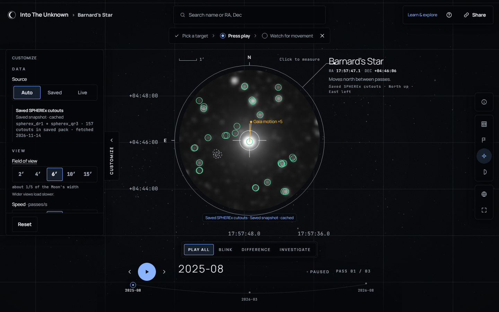
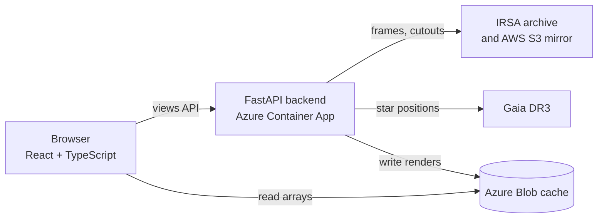
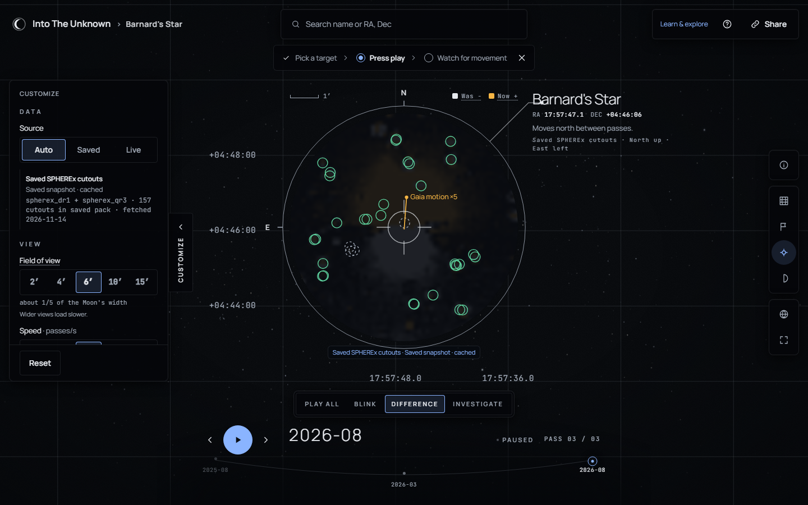

# Into The Unknown

> Team project built for NASA Space Apps 2026 (Planet X and SPHEREx challenge) with team LOGICA: [Om Patel](https://github.com/ompatel181005), [Diego](https://github.com/dflow11), Himanshu, [Ammar](https://github.com/ab1kenobi) and Angelo. Original repo: [ompatel181005/IntoTheUnknown](https://github.com/ompatel181005/IntoTheUnknown).
>
> I lead with the frontend, UI and UX.

[Live app](https://ca-planetx-api.politesand-6f83d8b5.westus.azurecontainerapps.io) (no login)

## Overview

SPHEREx is a NASA infrared telescope that maps the whole sky every six months. The data is public, but it comes as FITS files you have to query from Python. Into The Unknown takes any spot on the sky and plays the SPHEREx images of it as a short flipbook, so you can see what moved.

- Blink flips try to flip between several passes, to recreate the same way Clyde Tombaugh found Pluto.
- Difference subtracts one pass from another, so a moving star shows up as a dark and bright pair.

We built this interface for students, teachers, citizen scientists, and astronomers who want a quick look before downloading anything.

We tried our best to make the interface ui reflect that, and make playing around with the platform as enjoyable as possible. 

## My contributions

I built the React and TypeScript frontend. Several features of the interface we're parts we knew we wanted and I spent alot of the time sharpening where we wanted the platform to go. Some notable aspects include:

- The sky view which was all in React. It was an all-sky map, then a planetarium dome with a real RA/Dec grid and compass.
- The home orrery, where moving planets were drawn as shaded spheres and a camera that glides in.
- The guided tour, guide dialog, Customize panel, and a measurement drawer.
- The home point list, which loads pre-built views from Azure Blob.
- The hookup to the backend was where I connected the views API to the frontend.
- Reduced-motion fallbacks.

Om built the Azure deployment and the IRSA handling. Diego built the Gaia overlay and the refresh endpoint, and [UnusualGelo](https://github.com/UnusualGelo) built the Gaia data endpoint. Himanshu built the two-level Blob render cache.

## How it works

We planned for hundreds of targets to eventually be usable, so for any new target, the React app asks a FastAPI backend to build a view. It then finds the exposures, pulls cutouts, stacks one image per survey pass, aligns them to Gaia stars, and caches the result in Azure Blob. The browser reads the arrays from Blob and does blink and difference on a canvas.

We cache in Blob because a live build is slow. So the home list loads views we pre-rendered, and the five presets also ship as saved snapshots that work even with the API down (which it was. alot.).

Difference mode on Barnard's Star, last pass against the first:

For the Full design take a look at [`docs/SYSTEM_DESIGN.md`](docs/SYSTEM_DESIGN.md).

## Challenges and what I learned

The sky view worked but the dome jumped a few pixels at the end of every flight and overall having the interface flow smoothly was a struggle. Two layout changes happened after the flight destination was locked which eventually made the motion that much more expensive to draw. To fix the stutters, I cleaned up what was shown during the motion to ensure that what was shown was as high fps as I could achieve.

The reduced-motion bug was a smaller mistake. With "Animation effects" off in Windows, Firefox and Chrome report reduced motion, and my code skipped every transition in that mode, so some elements stayed hidden. I switched to zeroing the delays and fading the playback dock in.

It's still rough on phones and that was a part of the project that we didn't have time to sharpen out, so the preferred and more carried out page is on desktops.

## Demo

  

